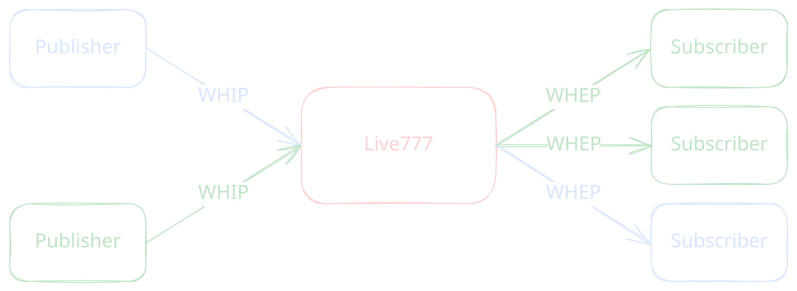

<h1 align="center">
  
  <br>Live777<br>
</h1>

<p align="center">
  <b>A low-latency WebRTC platform for audio, video and data</b>
</p>

<div align="center">
  <a href="https://live777.pages.dev/guide/what-is-live777">
    <b>Documentation</b>
  </a>
  |
  <a href="https://live777.pages.dev/zh/guide/what-is-live777">
    <b>中文文档</b>
  </a>
  |
  <a href="https://live777.pages.dev/llms.txt">
    <b>llms.txt</b> (for AI)
  </a>

  <br/>
  <br/>
</div>

<div align="center">

[](https://codecov.io/gh/binbat/live777)
[](https://github.com/binbat/live777/actions/workflows/rust.yml)
[](https://github.com/binbat/live777/releases)
[](./LICENSE)

</div>

<div align="center">
    <a href="https://discord.gg/mtSpDNwCAz"></a>
    &nbsp;
    <a href="https://t.me/binbatlib"></a>
    &nbsp;
    <a href="https://twitter.com/binbatlab"></a>
</div>

---

**Live777** is a low-latency WebRTC platform for audio, video and data — a very simple, high performance, lightweight SFU (**Selective Forwarding Unit**) core with a two-way RTP/RTSP gateway, and `WHIP`/`WHEP` as its first-class protocols.

Live777 works with [GStreamer](https://gstreamer.freedesktop.org/), [FFmpeg](https://ffmpeg.org/), [OBS Studio](https://obsproject.com/), [VLC](https://www.videolan.org/), [WebRTC](https://webrtc.org/) and other clients to receive and distribute streams — a typical publish (push) / subscribe (play) server model. Around the SFU core it records streams, bridges DataChannels, and captures hardware-encoded camera video on ARM boards.



## Features

- 📚 **Support `WHIP`/`WHEP`**

  Implements the WHIP/WHEP protocols for out-of-the-box interoperability with other WebRTC application modules — no custom adaptation required.

- 🗃️ **P2P/SFU Mix architecture**

  Only forwards media streams — no mixing, transcoding or other resource-hungry media processing on the server. Encoding and decoding stay on the sender and the receiver respectively.

- 🌐 **Multiple platform support**

  Native support for Linux, macOS, Windows and Android, on both ARM and x86.

- 🕸️ **Cluster & cascade**

  The companion `liveman` manager turns multiple Live777 nodes into a cluster — proxying client requests, managing cascade state between nodes, and coordinating recording across the cluster.

- 🎥 **Stream recording**

  Record published streams as fragmented MP4 segments to the local filesystem or S3-compatible object storage, controlled through the REST API.

- 📊 **WebUI & observability**

  An embedded WebUI, admin and session REST APIs, and Prometheus metrics are built in for easy operation and observability in production.

## Quick Start

The all-in-one `live777-all` image bundles the server, FFmpeg, the WHIP/WHEP tools
(`whipinto`, `whepfrom`, `whipsynth`, `whepprobe`) and a `smoke-test` command that
verifies the full publish → subscribe → decode loop (host networking is required):

```sh
docker run -d --name live777 --rm --network host ghcr.io/binbat/live777-all:latest
docker exec live777 smoke-test
```

`smoke-test` publishes a test stream over WHIP, plays it back over WHEP and decodes the
video with FFmpeg. On success it prints a `whepprobe` JSON report and exits `0`; on
failure it exits non-zero and prints diagnostics. Then open your browser at
`http://localhost:7777/`, and clean up with `docker stop live777`.

No server running yet? A single command starts a temporary server, checks it and cleans up:

```sh
docker run --rm --network host ghcr.io/binbat/live777-all:latest smoke-test --standalone
```

For prebuilt binaries, Linux packages, winget and cargo installs, see the [installation guide](https://live777.pages.dev/guide/installation).

## Tools

This repository also ships these companion tools:

| Tool | Description |
| ---- | ----------- |
| `liveman` | Cluster manager for multiple Live777 nodes |
| `whipinto` | RTP/RTSP → WHIP bridge: push RTP/RTSP streams into a WHIP endpoint |
| `whepfrom` | WHEP → RTP/RTSP bridge: pull a WHEP stream and output RTP/RTSP |
| `whipsynth` | Synthetic WHIP publisher: generated test patterns, no media source needed |
| `whepprobe` | `ffprobe`-style WHEP probe: verifies reachability and FFmpeg decoding |
| `whepwright` | Browser-based WHEP playback tester (Playwright) |
| `net4mqtt` | TCP/UDP-over-MQTT proxy and tunnel |

## Sponsors

This work is supported by Xidian University.

<p align="center">
  <a href="https://faculty.xidian.edu.cn/NGC/zh_CN/index.htm">
    
  </a>
  <br/>
  <a href="https://www.jetbrains.com/">
    
  </a>
  <br/>
  <a href="https://www.hostker.net/">
    
  </a>
</p>
